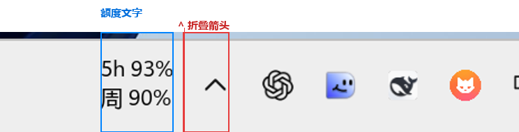
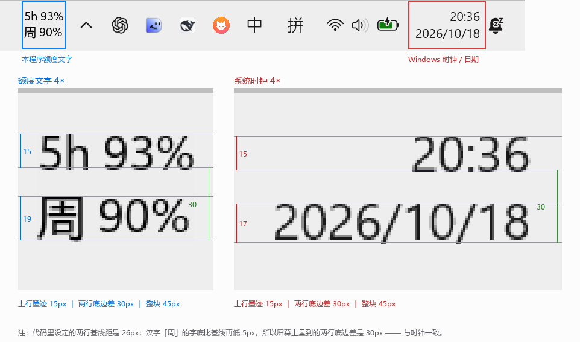
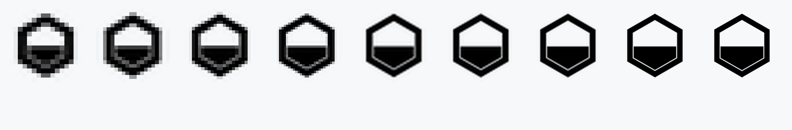
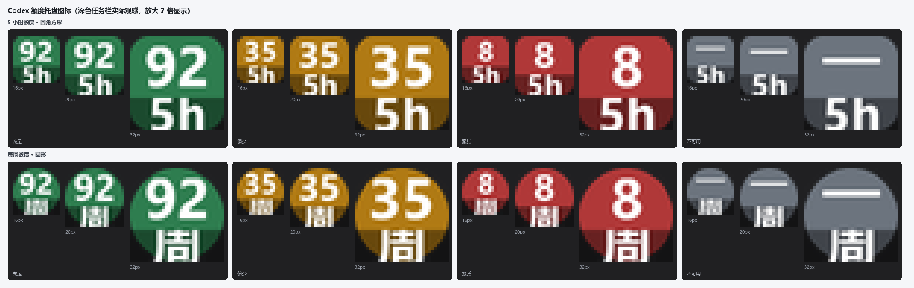

# Codex 额度（CodexQuotaTray）

在 Windows 任务栏折叠箭头 `^` **左侧**直接显示两行额度文字，不用点开托盘：

```
5h 98%          ^  ⌗  ⌗  ⌗
周 91%
```

上行是 **5 小时额度**、下行是 **每周额度**，都显示**剩余百分比**，两行左对齐。
字号、行距和整块高度都按本机 Windows 11 自带的时间／日期校准过
（数字墨迹高 15px、两行基线相距 30px，与系统时钟一致）。

悬停弹出卡片看两种额度的重置时间，右键只有「立即刷新」「退出」。
数据来自 Codex 自带的只读接口 `account/rateLimits/read`，不发推理请求、
不读写令牌、不向第三方传输数据。

**完全独立运行**：它不启动 Codex，也不跟随 Codex 关闭。Codex 开着或关着，
它都照常显示、照常每 15 秒刷新。



## 目录结构

```
codex额度监视/
├── src/
│   ├── main.py              入口：参数、单实例、刷新循环、控制器、退出兜底
│   ├── taskbar_label.py     任务栏两行文字（分层窗口、悬停卡片、右键菜单、跟随定位）
│   ├── quota.py             app-server JSON-RPC 客户端 + 返回解析 + 窗口识别
│   ├── tray.py              通知区域图标版（备用显示方式，--tray-icons）
│   ├── iconart.py           托盘图标绘制（备用方式使用）
│   ├── w32.py               Win32 薄封装（纯 ctypes，无第三方依赖）
│   └── applog.py            日志（%LOCALAPPDATA%\CodexQuotaTray\tray.log）
├── dist/CodexQuotaTray.exe  可运行版本（单文件，无控制台，约 17.3 MB，构建产物不入库）
├── build/build_exe.py       打包脚本（末尾会把 exe 完整性级别重置为「中」）
├── tools/make_shortcut.py   生成桌面快捷方式「Codex 额度」，并删除旧的「Codex + 额度」
├── assets/app.ico           程序与快捷方式图标（六边形 + 液位，9 个尺寸）
├── tests/test_quota_parse.py 额度解析单测（不依赖第三方库）
├── tests/manual/            手工验收脚本
├── docs/测试报告.md          验收项与实测结果
├── docs/images/             验收截图
└── 使用说明.md
```

## 为什么不是嵌进任务栏的子窗口

先试的是正统做法：把 `WS_CHILD` 窗口挂到 `Shell_TrayWnd` 下。
实测量到一个纯洋红的测试子窗口，**任务栏上一个像素都没出现**。

原因：Windows 11 的任务栏由 XAML 合成层绘制
（`Shell_TrayWnd` 下的 `Windows.UI.Composition.DesktopWindowContentBridge`，
以及 `DesktopWindowXamlSource`），经典子窗口被整个盖住；`TrayNotifyWnd` 里也没有任何
经典子窗口（折叠箭头是 XAML 画的，不是按钮窗口）。所以「嵌进去」这条路在
Win11 24H2/25H2（本机 build 26200）走不通。

采用的方案：**贴附任务栏的分层窗口**——
`WS_POPUP + WS_EX_LAYERED + WS_EX_TOOLWINDOW + WS_EX_TOPMOST`，
用 `UpdateLayeredWindow` 画透明背景的抗锯齿文字，右缘紧贴 `TrayNotifyWnd` 左缘
（即 `^` 的左边），垂直居中。视觉上和「长在任务栏里」没有区别，并且：

| 要求 | 处理方式 |
|---|---|
| 不遮挡已有按钮 | 右对齐到托盘区左侧，并检查任务列表右边界；空间不够就不显示 |
| 不抢焦点 | `WS_EX_NOACTIVATE` + `WM_MOUSEACTIVATE` 返回 `MA_NOACTIVATE`，左键消息只吞掉不处理；右键菜单关闭后把焦点还给原窗口 |
| 不在全屏应用上方悬浮 | 前台窗口铺满整个显示器时隐藏 |
| 任务栏自动隐藏 | 用任务栏矩形与显示器矩形的交集判断，滑出屏幕即隐藏 |
| 缩放 / 分辨率 / 托盘图标增减 | 每 500ms 重新解析几何，变了就跟着移动 |
| Explorer 重启 | 每 500ms 重新查找 `Shell_TrayWnd`，句柄变了自动跟上（本窗口不受影响） |
| 文字被任务栏盖住 | 检测 `WindowFromPoint` 命中，被压住才重新置顶（频繁置顶会打断提示卡片） |
| 点击穿透到任务栏 | 分层窗口按 alpha 命中，背景填 `alpha=1` 并让 `WM_NCHITTEST` 返回 `HTCLIENT` |

## 排版细节

- 字体混排：数字/拉丁用 **Segoe UI Variable Text**，中文用 **微软雅黑 UI**，
  按基线对齐拼在一行，避免中英文高度不一致。两者都是系统任务栏在用的字体。
- 字号跟随任务栏厚度缩放：`FONT_RATIO = 0.238`（本机 84px 厚 → 字号 20px）。
- 行距用「基线到基线」固定：`PITCH_PER_FONT = 1.3`（20px 字号 → 26px 基线距）。
  这里取 26 而不是时钟的 30，原因见下节：汉字字底比基线低，取 26 之后
  **屏幕上量到的两行底边差正好是 30px**，和时钟一致。
- 画完按墨迹紧裁，窗口矩形就等于文字范围：右缘贴托盘 10px，垂直居中偏差 ≤1px，
  悬停区域也正是这两行字。
- 文字颜色：浅色任务栏用纯黑，深色任务栏自动转白（否则看不清）。
- 加载中 / 失败也保持两行结构（`5h …`、`5h —`），不会突然变成一行或空白。

### 字号是怎么对齐系统时钟的

不是按任务栏厚度估的，是取同一屏截图分别量出来的（175% 缩放，任务栏厚 84px）。

这里有两件事要分开：**代码里的基线距**，和**人眼在屏幕上量到的行距**。
时钟两行都是阿拉伯数字，字底正好落在基线上，两个数一样；
本程序第二行是汉字「周」，字底比基线再低 5px，两个数就不一样了：

| | 代码基线距 | 实测两行底边差 | 实测整块墨迹 | 上行墨迹高 |
|---|---|---|---|---|
| 系统时间／日期 | 30px | 30px | 45px | 15px |
| 本程序额度文字 | 26px | 30px | 45px | 15px |

按「用户看到的效果」定成 26px：屏幕上的两行底边差、整块高度、数字墨迹高
都和时钟完全一致。



## 程序图标

exe 与桌面快捷方式用同一个图标：**六边形环 + 内部液位**。

- 六边形取自 Codex 标志中心的孔形，液位高低示意额度余量；
- 单色、纯线条、无底板，浅色环境为黑（本机桌面是系统默认浅蓝壁纸，对比度足够）；
- 9 个尺寸（16/20/24/32/40/48/64/128/256）分别渲染，小尺寸单独加粗笔画
  （16px 加粗到 1.68×），不是拿一张大图缩放，避免 16px 糊成一团。




> 注意：单个 `.ico` 不能随系统主题切换黑/白。当前做成纯黑，是因为本机壁纸较亮；
> 如果把桌面换成很暗的壁纸，黑色图案会不明显，需要换一版深色图标。

## 数据接口

Codex 桌面版自带 app-server，通过 stdio 收发 JSON-RPC：

```jsonc
{"jsonrpc":"2.0","id":2,"method":"account/rateLimits/read","params":null}
```

解析规则：

1. 额度桶的取用顺序：`rateLimitsByLimitId.codex` → 旧版 `rateLimits`。
   **`rateLimitsByLimitId` 里没有 `codex` 桶时，不会拿别的桶顶替** ——
   那些桶属于别的额度体系，拿来当 Codex 额度只会显示错数字。这种情况仍会先试旧版
   `rateLimits` 字段；两者都拿不到才判为不可用，并把实际有哪些桶写进错误信息便于排查。
2. 从 `primary` / `secondary` 里**按窗口时长识别**，只认能确认的窗口：
   `windowDurationMins` 必须**精确等于** 300（5 小时）或 10080（每周）；
   只有当分钟数是由 `limit_window_seconds` 换算出来时，才允许 ±1 分钟
   （秒→分钟的四舍五入误差）。
   时长缺失、或对不上（1440 / 43200 / 315 / 9600 …）一律忽略，那一侧显示「—」。
   **不按 `primary` / `secondary` 的位置兜底** —— 位置只是顺序、不代表语义。
3. `resetsAt` 是 epoch 秒；
4. 任何失败都丢弃旧快照，界面显示「—」，绝不拿过期数字冒充实时值。

对应的单测在 `tests/test_quota_parse.py`（16 个用例，含 1440/43200/315/9600
等反例和秒换算 ±1 的正反例）。

查询会常驻一个 `codex.exe app-server --stdio` 子进程（**只是命令行程序，不会打开
Codex 界面**）。退出时用 psutil 杀进程树，并把这棵子树放进 Job 对象
（`KILL_ON_JOB_CLOSE`），主进程被强杀也不会留孤儿。

## 构建

需要一个装了 Pillow / psutil / PyInstaller 的 Python 3.13：

```bat
.venv\Scripts\python.exe build\build_exe.py
```

产物是 `dist\CodexQuotaTray.exe`（单文件、无控制台）。脚本会自动：

1. 用 `sys.executable` 同目录的 `pyinstaller.exe` 打包；
2. **把产物 exe 的完整性级别重置为「中」**（见下节，这一步不能省）；
3. 把 `README.md`、`使用说明.md`、`docs\测试报告.md` 与 `docs\images\` 下的截图
   同步进 `dist\`（报告里的图片路径会自动改成 `docs/images/`，让 dist 目录能整体拷走）。

只改了文档、不想重新打包时，用这条命令单独同步：

```bat
.venv\Scripts\python.exe build\build_exe.py --docs-only
```

`dist\` 整体是生成产物，已在 `.gitignore` 里排除：exe 每次 17 MB，纳入版本库会让
`.git` 迅速膨胀，而它完全可以用上面一条命令重建。

### ⚠ 打包后必须重置完整性级别

如果项目目录被沙箱工具（例如 DSH 的工作区）打上了「低完整性」强制标签，
目录里新建的文件会继承该标签。Windows 对带完整性标签的可执行文件有特殊规则：
**由它启动的进程会以同样的低完整性运行**。低完整性下 PyInstaller 单文件
bootloader 读不出自己内嵌的 PKG 归档，会弹

```
Could not load PyInstaller's embedded PKG archive from the executable (...)
```

然后卡住；无控制台版本看起来就是「双击没反应」，而且一行日志都不写。

**首选做法是让标签从目录继承**（对 `dist` 执行一次即可，之后新生成的 exe 天生就是 Medium）：

```bat
icacls "dist" /setintegritylevel (OI)(CI)Medium
```

`build_exe.py` 会先读产物当前的完整性级别，只有确实是 Low 才去改；手动兜底：

```bat
icacls "dist\CodexQuotaTray.exe" /setintegritylevel Medium
```

注意：对**刚生成、可能仍被占用**的 exe 事后改标签会报「拒绝访问」，脚本会因此判定
构建失败并删掉产物。真的遇到时先做上面的目录继承，再重新打包即可。

同一个原因也会让项目内的 `.venv\Scripts\python.exe` 报
`failed to locate pyvenv.cfg`，修复方式相同：

```bat
icacls ".venv\Scripts\python.exe" /setintegritylevel Medium
```

## 上传 / 更新 GitHub

仓库：<https://github.com/l7047130-eng/codex-quota-tray>（公开）

本机代理只放行 `api.github.com`，`github.com` 的 HTTPS 出口被挡（`CONNECT tunnel
failed, response 502`），所以 `git push` 不通。更新用脚本走 REST API：

```bat
.venv\Scripts\python.exe tools\push_to_github.py --repo codex-quota-tray --use-stored-credential
```

它会向系统 git 凭据管理器要 token（也可以设 `GH_TOKEN` 环境变量），把本地提交
逐条重建成 blob → tree → commit → ref 再强推 `main`。作者、时间、提交信息、
甚至 commit SHA 都与本地一致，所以本地和远程是同一段历史，不会被改写成两条。

## 命令行

| 参数 | 作用 |
|---|---|
| `--interval N` | 刷新间隔秒数，默认 15，最小 5 |
| `--once` | 读一次额度打印 JSON 后退出 |
| `--tray-icons` | 改用通知区域图标显示（旧方式，备用；默认不创建任何托盘图标） |
| `--codex-exe PATH` | 指定 codex.exe 路径 |
| `--no-pin` | 仅 `--tray-icons` 模式：不自动把图标提升到可见区 |
| `--icon-preview PNG` | 渲染托盘图标预览图后退出 |
| `--version` | 版本号 |

> 没有 `--with-codex`：从 1.2.0 起程序不再启动 Codex、不再监测 Codex 窗口。

### 备用显示方式（`--tray-icons`）

默认是任务栏两行文字。加 `--tray-icons` 可以换回早期的通知区域图标
（两个小图标：方形是 5 小时、圆形是每周，颜色随剩余比例变化）：



## 依赖

运行期零外部依赖：Pillow 只用于文字渲染，psutil 用于进程树回收，
Win32 全部通过 ctypes 调用（不用 pywin32）。目标机不需要 .NET 或 Node。
