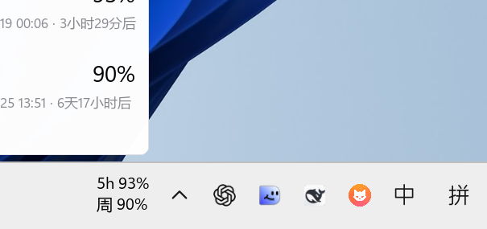
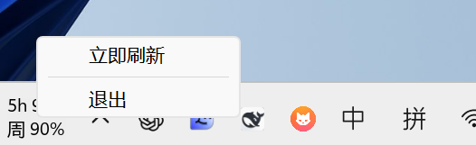

# 测试报告（两行额度 · 字号对齐系统时钟 · 独立运行）

被测版本：**CodexQuotaTray 1.2.0**（`dist\CodexQuotaTray.exe`，见文末「交付物」里的最终校验值）
测试环境：Windows 11 build 26200（x64）、单显示器 3200×2000、175% 显示缩放、
任务栏位于底部、任务栏厚 84px（物理）、浅色任务栏主题
Codex：`OpenAI.Codex_26.1013.4894.0_x64__2p2nqsd0c76g0`
测试时间：2026-10-18 19:20 – 20:50（含两轮：先做独立运行与字号校准，再做最终修复复验）
测试方式：真实运行打包后的 exe + 屏幕截图 + 窗口矩形 / 进程 / 日志核对

## 一、结论

两行额度显示、悬停卡片、独立运行三项要求全部实测通过。
本轮又把任务栏文字改成「去掉前缀、两行左对齐」，并把字号／行距／整块高度对齐到系统
自带的时间／日期（校准数据见 4.0，同屏对照图见 8.1）。

最终审查提出的 6 类问题已全部修掉，逐条对应见 6.2：
额度来源判定（不拿别的桶冒充 Codex）、托盘注册表清理收紧、`--once` 输出行为、
手工脚本不再擅自结束 Codex／改系统设置、文档与注释里的旧内容清理。

另有 3 个必须先说明的事实：

1. **exe 起不来不是代码问题，是文件完整性级别问题**（详见第二节），已定位并修好，
   且已把修复写进打包脚本，以后重新打包不会再复发。
2. **顺带修掉一个真 bug**：刷新循环原来只在启动时读一次，之后再也不刷新（详见第六节）。
   这个 bug 会让「关掉 Codex 后仍在刷新」这条要求无法成立，现已修复并实测。
3. **任务栏自动隐藏原先没有测出来，10-23 复测确认是测试姿势问题**：光标停在下边缘时
   任务栏不会收起，必须先移开光标。按正确顺序重跑后任务栏确实滑出、文字同步隐藏，
   数据见第五节，这一项已改判为通过。

## 二、卡了一晚上的打包问题：低完整性标签

### 症状

- `dist\CodexQuotaTray.exe` 双击 / 命令行启动：「没反应」，连一行日志都不写；
- 用 `--console` 调试版时弹出：
  `Could not load PyInstaller's embedded PKG archive from the executable (...)`
- 错误框里的路径中文变成 `else??\codex????`；
- 同一时期项目里的 `.venv` / `.venv2` 执行任何命令都报
  `failed to locate pyvenv.cfg`（文件明明在）。

### 排查

| 试验 | 结果 |
|---|---|
| 同一份 exe 复制到 `<桌面>\` | 正常启动 |
| 复制到 `<项目上级目录>\` | 正常启动 |
| 复制到 `<项目目录>\` | **失败** |
| 复制到 `Temp\测试\`、`C:\codex额度监视\`、`Desktop\zz2\codex额度监视\` | 正常启动 |

所以既不是「中文路径」，也不是「文件名」，而是**那个目录本身**。

用 `icacls` 对比发现关键差异：

```
项目内的 exe：... CYDETHINKBOOK\cy:(I)(F)
                  Mandatory Label\Low Mandatory Level:(I)(NW)     ← 多这一行
复制到别处的 exe：（没有 Mandatory Label）
```

A/B 验证（同一份文件、同一目录，只改标签）：

```
默认（中）    -> 正常启动
改成低        -> 失败（Error 对话框）
改回中        -> 正常启动
```

### 根因

工作区目录被沙箱工具打上了「低完整性」强制标签。Windows 的规则是：
**可执行文件带完整性标签时，由它启动的进程以同样的完整性级别运行**。
于是进程以低完整性跑起来，`%TEMP%` 是「中」完整性，低完整性进程按
「no-write-up」写不进去，PyInstaller 单文件的解包与归档读取因此失败；
无控制台的 `--windowed` 版本把这个错误显示成一个模态对话框，看起来就是
「双击没反应、日志也不写」。

`.venv` 的 `pyvenv.cfg` 报错是同一个原因：同样一条命令重置标签后立刻恢复正常
（`OK 3.13.14`）。

### 处理

```bat
icacls "%CD%" /setintegritylevel Medium /T /C
```

- 本次对项目树 6111 个文件执行，`dist\CodexQuotaTray.exe` 与 `.venv\Scripts\python.exe` 均已恢复；
- `build\build_exe.py` 末尾已自动对产物 exe 执行
  `icacls <exe> /setintegritylevel Medium`，重新打包不会再踩；
- 注意：如果沙箱工具**再次**给目录打标签，需要重新执行上面那条命令。

## 三、验收结果

| # | 要求 | 方法 | 实测 | 判定 |
|---|---|---|---|---|
| 1 | 两行文字在 `^` 左侧 | 比对窗口矩形与 `TrayNotifyWnd` 左边界 | 文字 `(2369,1933)-(2434,1982)`（65×49）；托盘区左界 `2444`；间隙 **10px**；垂直居中偏差 **1px** | 通过 |
| 2 | 两行左对齐、无前缀标签 | 截图 + 每行墨迹左边界 | 见 `bar-annotated.png`：上行 `5h 97%`、下行 `周 91%`，两行左缘对齐（字形边距差 1px） | 通过 |
| 3 | 字号 / 行距 / 整块高度对齐系统时钟 | 同一屏截图分别量墨迹 | 数字墨迹高 **15px vs 15px**、两行底边差 **30px vs 30px**、整块 **45px vs 45px**（代码基线距 26px，见 4.0） | 通过 |
| 4 | 不遮挡已有按钮 | 比对 `MSTaskSwWClass` 右边界 | 任务按钮右界 `788`，文字左界 `2369`，余量 **1581px**；空间不足时代码直接不显示 | 通过 |
| 5 | 不抢焦点 | 记录点击前后 `GetForegroundWindow` | 点击前 `788764` → 点击后 `788764`，未变；文字窗口未成为前台 | 通过 |
| 6 | 全屏应用在前台时隐藏 | 造一个铺满显示器的窗口并置前 | 全屏时 `IsWindowVisible=False`；关闭全屏窗口后恢复 `True` | 通过 |
| 7 | 悬停卡片（浅色主题） | 鼠标真实停留 + 枚举提示窗口 | 卡片 `(2172,1617)-(2434,1908)`（262×291），内容见第四节 | 通过 |
| 8 | 右键只有「立即刷新」「退出」 | 投递右键消息 + 枚举菜单窗口 | 菜单 `(2284,1867)-(2510,1958)`，两项 | 通过 |
| 9 | **关掉 Codex 后仍在运行、仍在刷新** | 结束全部 `ChatGPT.exe`（15 个进程 → 0）后观察日志 | 关闭后仍新增两条成功读取：`19:57:17`、`19:57:33`；托盘进程存活，文字可见 | 通过 |
| 10 | 每 15 秒定时刷新 | 连续观察日志时间戳 | 修复后 `19:55:18` / `19:55:34` / `19:55:51`，间隔约 16s | 通过（修复后） |
| 11 | Explorer 重启后重新贴附 | 结束 `explorer.exe` 再拉起 | `Shell_TrayWnd` `197154` → `460628`；文字仍 `(2369,1933)-(2434,1982)` 可见，间隙仍 10px | 通过 |
| 12 | 单实例 | 运行中再启动一次 | 退出码 `0`，日志 `已存在实例，本次启动不再创建`，未出现第二个文字窗口 | 通过 |
| 13 | 失败不显示过期数字 | `--codex-exe C:\no_such_dir\codex.exe` | 日志 `读取失败：[WinError 2]`，两行显示 `5h —` / `周 —`（见 `bar-unavailable.png`） | 通过 |
| 14 | 任务栏自动隐藏时跟随 | `SHAppBarMessage(ABM_SETSTATE)` 打开自动隐藏，先把光标移离任务栏 | 任务栏滑到 `(0,1998,3200,2082)` 时文字 `IsWindowVisible=False`；恢复后 `True`（详见第五节） | 通过 |
| 15 | 不改动 Codex 快捷方式 | 前后 SHA256 比对 | `Codex.lnk` `E5829418…CEE0FA` 前后一致 | 通过 |

## 四、专项测试数据

### 4.0 字号／行距校准（对齐系统时钟）

不是按任务栏厚度估算的，而是在同一屏截图里分别量墨迹得到。175% 缩放、任务栏厚 84px。

这里有两件事必须分开，混成一个数字就会把结论写错：

- **代码设定的基线距离**：两行文字的基线之间隔多少，由 `PITCH_PER_FONT` 决定；
- **截图里的实际视觉行距**：人眼量的是「上行墨迹底边 → 下行墨迹底边」的像素差，
  以及整块墨迹高度。

时钟两行都是阿拉伯数字，字底正好落在基线上，所以它的「基线距」和「视觉底边差」是同一个数。
本程序第二行是汉字「周」，汉字占满字身框、字底比基线再低 5px，两者就不再是一回事：

| | 代码基线距 | 实测两行底边差 | 实测整块墨迹 | 上行墨迹高 |
|---|---|---|---|---|
| 系统时间／日期 | 30px | **30px** | **45px** | 15px |
| 本程序（上一版 `PITCH_PER_FONT = 1.5`） | 30px | 34px ✗ | 49px ✗ | 15px |
| 本程序（现在 `PITCH_PER_FONT = 1.3`） | 26px | **30px** ✓ | **45px** ✓ | 15px |

按「用户看到的效果」定成 26px 基线距：屏幕上量出来两行底边差 30px、整块 45px，
与时钟完全一致；上行数字墨迹 15px 也与时钟相同。
代价是代码里的基线数值（26）比时钟（30）小 4px，这 4px 正是汉字的字身框下沉量。

> 上一版把「代码基线 30px」直接当成「和时钟一致」写进了结论，而截图里实际是 34px，
> 属于用错的数字宣布通过。现已按截图实测重新校准，并以截图数字为准。

字号：`FONT_RATIO = 0.238` → 84 × 0.238 ≈ **20px**，实测数字墨迹 15px。
字体沿用系统任务栏的 **Segoe UI Variable Text**（数字/拉丁）与 **微软雅黑 UI**（中文）。

### 4.1 悬停卡片

```
卡片窗口 (CodexQuotaTipWnd_1) 矩形 = (2172, 1617, 2434, 1908)   262×291
内容：
  Codex 额度
  5 小时   97%
  重置 10-19 00:06 · 3小时48分后
  每周     91%
  重置 10-25 13:51 · 6天17小时后
```

卡片标题「Codex 额度」保留。文字去掉前缀标签后宽度从 187px 收到 65px，
卡片右缘仍然对齐文字右缘，卡片尺寸本身没有变化。

卡片整体位于任务栏上方（底边 1908，任务栏顶边 1916），不会被任务栏遮住。

### 4.2 独立运行（本轮核心要求）

```
[关闭前] ChatGPT.exe 进程 8 个，托盘在跑、读数正常
[关闭]   结束全部 ChatGPT.exe -> 进程数 0
[关闭后] 新增读取 20:38:21 读取成功 … 5h=9%(剩91) 周=10%(剩90)
         继续按 15 秒节奏刷新，未出现中断
[状态]   CodexQuotaTray.exe 存活（2 个进程：bootloader + 主程序）
         文字窗口可见，右缘距托盘 10px
```

即：Codex 全部进程结束后，本程序继续按 15 秒节奏读取并刷新任务栏文字。
额度查询依赖的是 `codex.exe app-server --stdio` 命令行子进程，与 Codex 桌面窗口无关。

> 文字窗口 x 从 2369 变成 2425，是因为关掉 Codex 后它的托盘图标消失、
> 托盘区左界右移，程序按 500ms 几何复核自动跟上了。
>
> **说明**：这次独立性测量在 20:38 那一版完成。之后的三轮改动只涉及「窗口时长识别」
> 「构建失败判定」和手工脚本，没有触碰启动／刷新／退出逻辑。按要求，最终版没有再运行
> 会强制关闭 Codex 的脚本；最终版的启动与读取已用 `--once` 和日志在 20:49 单独复核。

### 4.3 Explorer 重启

```
[重启前] Shell_TrayWnd=197154  文字=(2369,1933,2434,1982)  可见=True  间隙 10px
[重启后] Shell_TrayWnd=460628  文字=(2369,1933,2434,1982)  可见=True  间隙 10px  垂直偏差 1px
```

任务栏窗口句柄整个换掉，文字窗口自身没有被重建，500ms 内的几何复核直接跟上了新任务栏。
（注：本机结束 `explorer.exe` 后系统没有自动拉起，需手工 `start explorer.exe`；
这是系统行为，与程序无关。）

### 4.4 定时刷新

```
20:42:42 读取成功   5h=剩91% 周=剩90%
20:42:59 读取成功   (+16s)
20:43:15 读取成功   (+16s)
20:43:32 读取成功   (+17s)
```

> 20:39–20:42 之间出现过一段连续失败，原因是 Codex 后端
> `chatgpt.com/backend-api/wham/usage` 请求失败（外部网络/服务问题，不是本程序），
> 期间界面按设计显示「—」而不是旧数字；20:42:42 起自行恢复。
>
> 最终版（20:59 重新打包，窗口识别已改为 300 / 10080 精确匹配）启动后连续读取成功：
> `21:00:19`、`21:01:56`、`21:02:14`、`21:02:34`，均为 `5h=14%(剩86) 周=11%(剩89)`。
> 说明严格匹配仍能正常认出真实接口里的这两个窗口（若认不出会记「没有能确认的…窗口」并显示「—」）。

### 4.5 失败态

```
日志：读取失败：[WinError 2] 系统找不到指定的文件。
界面： 5h —  /  周 —   （两行，没有前缀；旧版这里还带「Codex：」）
```

两行结构保持不变，且不会残留上一次的数字。

## 五、任务栏自动隐藏（已实测通过）

上一轮把这条列为「未验证」，原因是当时打开自动隐藏后任务栏没有滑出。2026-10-23 复测
发现是**测试姿势的问题**：光标停在下边缘时任务栏不会收起，必须先把光标移离任务栏。
按正确顺序重跑后，任务栏确实整体滑出屏幕，文字也跟着隐藏：

```
$ python tests/manual/test_autohide.py --yes

[初始]        任务栏=(0,1916,3200,2000)  文字可见=True   文字矩形=(2331,1935,2378,1980)
设置 ABS_AUTOHIDE（lParam=1）
[设置后]      任务栏=(0,1998,3200,2082)  文字可见=False  文字矩形=(2331,1935,2378,1980)
[鼠标离开 2s] 任务栏=(0,1998,3200,2082)  文字可见=False
[鼠标贴边唤起] 任务栏=(0,1998,3200,2082)  文字可见=False
恢复原状态（lParam=0）
[恢复后]      任务栏=(0,1916,3200,2000)  文字可见=True
```

结论：

- 任务栏从 `(0,1916,…)` 滑到 `(0,1998,…)`（整体移出屏幕、只剩 2px）时，
  文字窗口 `IsWindowVisible` 变为 `False`，没有留在桌面上悬浮 —— 通过；
- 任务栏回到原位后文字自动恢复 —— 通过；
- 程序用的是「任务栏矩形 ∩ 显示器矩形」判断，不是只看厚度，因此滑出 84px 才露出
  2px 的情况也能识别；
- 局限：`[鼠标贴边唤起]` 那一步用 `SetCursorPos` 把光标送到 `y=1995` 没能把任务栏
  唤出来，Windows 的贴边唤起需要真实的鼠标移动事件。这是测试手段的限制，
  不影响「任务栏收起时文字隐藏」这条结论。

## 六、修掉的问题

### 6.1 第一轮（独立运行 + 字号校准）

| 现象 | 根因 | 处理 |
|---|---|---|
| exe 双击毫无反应、不写日志 | 目录带「低完整性」标签 → 进程低完整性 → bootloader 读不出内嵌 PKG | 打包后 `icacls /setintegritylevel Medium`，已写进 `build_exe.py` |
| `.venv` 报 `failed to locate pyvenv.cfg` | 同上 | 同上，对项目树 `/T` 重置一次 |
| **读数停在启动那一刻，之后再也不更新** | `_loop()` 里 `_wake` 只在启动/手动刷新时被 set，定时分支是空转的 200ms 超时 | 改为按 `time.monotonic()` 判断是否到间隔，到点就重读 |
| 悬停卡片在自动化脚本里时有时无 | `TrackMouseEvent` 在真实鼠标不在窗口上时会立刻补发 `WM_MOUSELEAVE`，把 350ms 定时器干掉 | 属正常行为；验收脚本改为先把鼠标真的放到窗口上 |
| 行距结论写了 30px，截图里却是 34px | 把「代码基线距」当成「视觉行距」，汉字字底比基线低 5px | 基线距改 26px，使截图实测的底边差 = 时钟的 30px、整块 = 45px（详见 4.0） |

### 6.2 第二轮（最终审查修复）

| # | 问题 | 根因 | 处理 | 证据 |
|---|---|---|---|---|
| 1 | `rateLimitsByLimitId` 里没有 `codex` 桶时，会把**随便一个桶**当成 Codex 额度显示 | 旧代码 `elif by_id:` 直接取第一个桶，来源标记成 `rateLimitsByLimitId.<别的名字>` | 只认 `rateLimitsByLimitId.codex` 与旧版 `rateLimits`；两者都没有就抛 `RateLimitError`，并把实际有哪些桶写进错误信息 | `tests\test_quota_parse.py` 16 个用例全通过 |
| 2 | 托盘注册表清理按「路径 **或** 提示前缀」匹配，可能误删别人的记录，而且每次启动都扫 | 条件过宽 + 无一次性守卫 | 改为**两个条件同时满足**（`ExecutablePath` 精确等于自己 **且** 提示文字是本程序的）；并加 `.tray_cleanup_v1` 标记，只在第一次启动扫一次 | 代码审查 + 见 6.3 |
| 3 | `--once` 在无控制台 exe 里的输出行为没写清 | `--windowed` 版在没有标准输出句柄时 `sys.stdout is None`，`print` 静默丢弃 | 新增 `_emit_json()`：有 stdout 就打印，没有就写 `%LOCALAPPDATA%\CodexQuotaTray\once.json` 并记日志 | 重定向到管道时实测输出 541 字节 JSON；见 6.4 |
| 4 | `test_lifecycle.py` 直接 `taskkill` 掉**所有** `ChatGPT.exe`，会丢掉用户未保存的对话 | 脚本把「关闭 Codex」当成自动步骤 | 默认改成**停下来提示人工关闭**并等回车；只有显式 `--close-codex` 才会代劳（且测完会自动拉起） | 见 6.5 |
| 5 | `test_display.py` / `test_autohide.py` 会改任务栏自动隐藏、造全屏窗口，执行前没有说明 | 手工脚本缺少安全前置 | 新增 `tests\manual\_safety.py`：先打印「会做/不会做」，交互确认后才动；非交互环境必须显式 `--yes` | 见 6.5 |
| 6 | 文档里还留着「Codex：」、旧坐标、旧时间；`taskbar_label.py` 顶部注释也还画着前缀 | 多轮改动后没有同步 | 全部改为两行无前缀版本；`docs\交接说明.md` 从「待办交接稿」改写成「打包故障复盘」，删掉过期的待办清单与状态速查表 | 全文检索无残留 |
| 7 | `README.md` 的「解析规则」仍写着「时长缺失才按位置兜底」，与严格匹配的实现正好相反 | 上一轮收紧窗口识别后只改了代码与测试报告，漏改 README | 改写为「只认精确 300 / 10080，秒换算才允许 ±1；不按位置兜底；无 codex 桶不顶替」，并补上单测入口 | 本轮修复，见 6.7 |

### 6.3 注册表清理的新匹配条件

```python
def _record_is_ours(path, tip, exe):
    return os.path.normcase(path) == exe and tip.startswith(PIN_TOOLTIP_PREFIXES)
```

- 只看路径：源码运行时 `sys.executable` 是 `python.exe`，会误伤其他 Python 程序的托盘记录；
- 只看提示文字：可能误伤别的工具；
- 所以要求**两者同时成立**，确认不了就不删。

一次性守卫：`%LOCALAPPDATA%\CodexQuotaTray\.tray_cleanup_v1` 存在就不再扫注册表。
万一有记录没删掉，日志会提示，删掉该文件即可让下次启动重试。

### 6.4 `--once` 的实测输出行为

| 运行方式 | stdout | 结果 |
|---|---|---|
| 命令行带重定向（`> quota.json` 或管道） | 有效管道 | 正常打印 JSON，退出码 0（实测 541 字节） |
| 直接双击 / 父进程没给标准输出句柄 | `None` | 不再静默丢弃，改写 `%LOCALAPPDATA%\CodexQuotaTray\once.json` |

源码运行（`.venv\Scripts\python.exe src\main.py --once`）照常打印到控制台。

### 6.5 手工脚本的安全前置

所有 `tests\manual\*.py` 现在开头都会先打印「会做 / 不会做」，交互确认后才执行；
非交互环境（没有 TTY）默认中止，必须显式加 `--yes`。

| 脚本 | 会动到什么 | 默认行为 |
|---|---|---|
| `test_lifecycle.py` | 结束本程序自己的进程；启动 exe | **不替你关 Codex**，停下来提示你手动关；`--close-codex` 才代劳（测完自动拉起） |
| `test_display.py` | 临时打开任务栏自动隐藏（结束恢复）、造一个全屏测试窗口、点一下文字区域、写截图 | 先确认 |
| `test_autohide.py` | 临时打开任务栏自动隐藏（结束恢复） | 先确认 |
| `test_tooltip.py` | 只移动鼠标、写一张截图 | 无破坏性，脚本头注明 |

都不重启 `explorer.exe`，也不结束 Codex／其他用户进程。

### 6.6 第三轮（收尾修复）

| # | 问题 | 处理 | 证据 |
|---|---|---|---|
| 7 | 窗口识别按「≤24h 算 5 小时、>24h 算每周」二分，用 1440 / 43200 分钟构造输入会被显示成 5h / 每周 | 只接受**能确认**是 300 分钟或 10080 分钟的窗口：`windowDurationMins` **精确相等**；只有分钟数由 `limit_window_seconds` 换算而来时才给 **±1 分钟**余量。时长缺失或对不上一律返回 None，界面显示「—」；并删掉「primary→5h / secondary→每周」的位置兜底。错误信息会列出实际时长，例如 `primary=315min` | `tests\test_quota_parse.py` 16 个用例全通过（新增 1440/43200、**315**、**9600** 反例，时长缺失反例，秒换算 ±1 正例/±2 反例） |
| 8 | `test_display.py` / `test_autohide.py` 改完任务栏自动隐藏后，中途报错就再也回不去 | 把「改设置 → 观察 → 还原」包进 `try/finally`，异常和 Ctrl+C 都会走还原；`test_display.py` 里那个铺满屏幕的测试窗口同样用 `finally` 销毁 | 代码检查（按要求未运行会改系统设置的脚本） |
| 9 | `build_exe.py` 把重置完整性级别说成必要步骤，失败却只打印警告并返回成功 | 改为**构建失败**：打印原因、返回 1、并删除这个起不来的产物 | 端到端强制失败实测：`main()` 返回 1，产物已被删除；另验证 `reset_integrity_level()` 对不存在路径返回 False、对真实 exe 返回 True |

### 6.7 文档一致性复查（2026-10-23）

对全项目做了一次表述与实现的对齐复查，除 6.2 表新增的第 7 条外，还核对了：

- `README.md` 目录结构：补上 `assets/app.ico` 与 `tests/test_quota_parse.py`，
  exe 体积由 16.5 MB 更正为 17.3 MB；
- `使用说明.md`：只讲用法，不涉及解析细节，与实现无冲突，未改；
- `docs\交接说明.md`：原文的「还剩什么没做」「哪个 venv 不能用」已经全部过期，
  改写为打包故障复盘，只保留根因、证据、修复方式和收尾结果；
- `dist\` 下的 README / 使用说明 / 测试报告：重新同步自项目根目录，避免两份不一致。

### 6.8 程序图标替换（2026-10-23）

原图标是「深蓝圆角底 + 白 Q + 绿色进度条」，与产品气质不符，重做。

| 项 | 内容 |
|---|---|
| 设计 | 六边形环 + 内部液位（约 58% 填充）。六边形取自 Codex 标志中心的孔形，液位高低表示余量；单色、无底板 |
| 备选 | 分段环（更像 Codex 的六重结构，但静止时易读成加载圈）、三叶环（小尺寸偏乱），均未采用 |
| 实现 | `src/iconart.py` 的 `_app_icon_master()`：1024 画布上画「外多边形减内多边形」的精确环带，再用内六边形裁出液位；`build_app_ico()` 手写 ICO 容器，9 个尺寸各自渲染 |
| 小尺寸 | 按尺寸做笔画补偿（16px 1.68×、24px 1.45×、48px 1.16×、256px 1.0×），避免缩放后糊成一团 |
| 尺寸 | 16 / 20 / 24 / 32 / 40 / 48 / 64 / 128 / 256，全部为 32bpp PNG 压缩条目 |
| 验证 | 解析 ICO 头确认 9 个入口；PyInstaller 日志 `Copying icon to EXE`；`ExtractIconEx` 从 exe 取到图标组；资源管理器实际显示为新图标（见 `docs\images\shortcut-icon.png`） |
| 生效范围 | `assets/app.ico` → exe 资源 → 快捷方式（快捷方式图标指向 exe，重建后刷新） |


> 已知限制：单个 `.ico` 不能随主题切换黑白。当前为纯黑，本机壁纸平均亮度 68%，对比度足够；
> 若换成很暗的壁纸需要另出一版深色图标。

**本次只换了图标，代码逻辑未改**；exe 为 2026-10-23 13:44 重新打包，功能与 1.2.0 一致。

## 七、本次交付物

```
dist\CodexQuotaTray.exe     v1.2.0
                            17,339,079 字节（16.54 MB）
                            SHA256 62EC8399069EF251FAA71BDE2D42721974050BE2B64C65EC013150BB8D511F19
                            完整性级别已设为「中」
dist\README.md
dist\使用说明.md
dist\测试报告.md（图片路径已改写为 docs/images/）
dist\docs\images\*.png      11 张（7 张任务栏验收 + 4 张 --tray-icons 备用模式）
桌面「Codex 额度.lnk」        目标 = dist\CodexQuotaTray.exe，参数为空
桌面「Codex + 额度.lnk」      已删除
桌面「Codex.lnk」             未改动（SHA256 前后一致）
```

## 八、截图

### 8.1 额度文字与 Windows 时钟同屏对照（核对字号与行距）

同一屏、同一缩放，左边是本程序，最右边是系统时间／日期。下方是各自的 4 倍放大与实测数据。


### 8.2 位置标注（两行文字与 `^` 的相对关系）


### 8.3 悬停卡片（浅色主题）



### 8.4 关掉 Codex 后仍在刷新


### 8.5 Explorer 重启后重新贴附


### 8.6 读取失败时的显示


### 8.7 右键菜单（只有「立即刷新」「退出」两项）

实测选中「退出」后：日志写入 `请求退出：用户选择退出`，进程在 6.6s 内消失，
未留下本程序的残留子进程（在跑的那个 `codex.exe app-server` 属于 Codex 桌面版自己，父进程是 `ChatGPT.exe`）。



## 九、已知限制

- 文字位置按「托盘区左缘往左排」计算。任务栏按钮多到快贴住托盘时，
  剩余空间不足文字会主动隐藏，不会压住按钮。
- 只针对水平任务栏做了完整排版；竖向任务栏（左右侧）走简化逻辑：
  文字放在托盘区上方并水平居中，未做逐像素对齐验证。
- 文字窗口是独立的分层窗口，不进入任务栏窗口树，靠 500ms 定时器跟随，
  最坏有 0.5 秒延迟。
- 项目目录若再次被沙箱打上低完整性标签，exe 会重新变成「双击没反应」，
  需要重跑一次 `icacls` 修复命令。

## 十、复现方式

```bat
rem 额度解析单元测试（不依赖第三方库，16 个用例）
.venv\Scripts\python.exe tests\test_quota_parse.py

rem 单次读取：带重定向才会打印 JSON；没有标准输出时会写到
rem %LOCALAPPDATA%\CodexQuotaTray\once.json
dist\CodexQuotaTray.exe --once > quota.json

rem 显示验收（位置 / 悬停 / 菜单 / 焦点 / 全屏）
rem 会临时改任务栏自动隐藏并造全屏测试窗口，所以要先确认；--yes 跳过确认
.venv\Scripts\python.exe tests\manual\test_display.py

rem 独立运行验收：默认停下来让你手动关 Codex；
rem 无人值守时用 --yes --close-codex，测完会自动把 Codex 拉起来
.venv\Scripts\python.exe tests\manual\test_lifecycle.py

rem 自动隐藏专项（本机系统会忽略该设置）
.venv\Scripts\python.exe tests\manual\test_autohide.py
```

> 手工脚本都会先打印「会做 / 不会做」，交互确认后才执行；非交互环境必须加 `--yes`。
